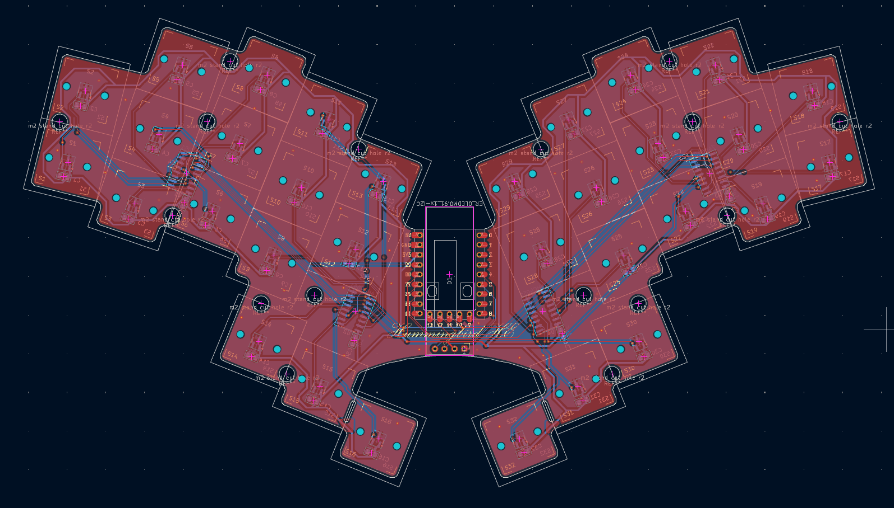

# Hummingbird-HE

Hall-effect variant of Hummingbird keyboard.

32 keys with detachable extra thumb key, otherwise the same layout as Rufous.

Firmware / configurator to be added.

## Licenses
All code under firmware folder follows GPL v3.

Webapp / HW is MIT license.

## Disclaimer
Webapp and firmware modification were vibe coded.
